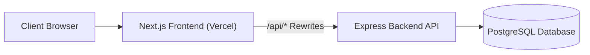

# 🚀 Vercel & Backend Hosting Checklist (ACE Forge)

This checklist explains how to host your split architecture (**Next.js Frontend on Vercel** + **Express Backend on Render/Railway/Fly.io/VPS** + **PostgreSQL**).

---

## 🏗️ Architecture Overview



> [!NOTE]
> **Why did the frontend mention Postgres?**
> The frontend (`ACE_WEB`) is a pure Next.js client. It **does NOT directly connect to PostgreSQL**. All data requests are proxied via `next.config.ts` to the backend Express server. If Vercel complains about Postgres or `DATABASE_URL`, it was because old backend environment schemas or `.env.example` were asking for it. The frontend only needs `BACKEND_API_URL` and `JWT_SECRET`!

---

## 🌐 1. Frontend Checklist (Hosting on Vercel)

### Environment Variables to set in Vercel Dashboard
Set these in **Vercel > Project Settings > Environment Variables**:

| Variable | Required | Value / Description |
| :--- | :---: | :--- |
| `BACKEND_API_URL` | **YES** | URL of your deployed backend, e.g. `https://ace-backend.onrender.com` |
| `NEXT_PUBLIC_API_URL` | **YES** | Same backend URL: `https://ace-backend.onrender.com` |
| `JWT_SECRET` | **YES** | 32+ char secret. **Must match the backend's `JWT_SECRET`** so middleware can verify cookies. |
| `JWT_EXPIRES_IN` | Optional | Defaults to `7d` |

### Vercel Project Settings
- **Framework Preset**: Next.js
- **Root Directory**: `./` (Root directory of `ACE_WEB`)
- **Build Command**: `next build`
- **Output Directory**: `.next`

---

## 🖥️ 2. Backend Checklist (Hosting on Render / Railway / Fly.io / VPS)

The Express backend (`/backend`) handles all business logic, database operations via Prisma, email dispatches, and Gemini AI reviews.

### Database Connection Protection
- The backend has been configured to **verify the database connection on startup before opening port 4000**:
  - If PostgreSQL is connected: `✅ [DATABASE] PostgreSQL connected successfully!` and server starts listening.
  - If PostgreSQL is down or `DATABASE_URL` is missing: The server halts with a clear error and will **never start in a broken state**.

### Environment Variables for Backend Server
Add these in your backend hosting provider (e.g. Render/Railway):

| Variable | Required | Description |
| :--- | :---: | :--- |
| `PORT` | Optional | Usually assigned automatically by host (default `4000`) |
| `NODE_ENV` | **YES** | `production` |
| `CORS_ORIGIN` | **YES** | Your Vercel frontend URL, e.g. `https://your-frontend.vercel.app` |
| `DATABASE_URL` | **YES** | Pooled PostgreSQL connection string from Neon / Supabase / Railway / RDS |
| `JWT_SECRET` | **YES** | Same secret as frontend |
| `APP_BASE_URL` | **YES** | Your Vercel frontend domain: `https://your-frontend.vercel.app` (used in emails) |
| `CRON_SECRET` | **YES** | Secret key for cron authorization |
| `EMAIL_DEV_MODE` | **YES** | Set to `false` for real email sending |
| `SMTP_HOST` | **YES** | Production SMTP host (Gmail / Resend / SendGrid / Mailgun) |
| `SMTP_PORT` | **YES** | `465` or `587` |
| `SMTP_USER` | **YES** | SMTP username |
| `SMTP_PASS` | **YES** | SMTP password / app password |
| `EMAIL_FROM` | **YES** | e.g. `ACE Forge <noreply@yourdomain.com>` |
| `GEMINI_API_KEY` | **YES** | Google AI Studio Gemini API Key |
| `GITHUB_TOKEN` | Recommended | GitHub Personal Access Token (for repo inspection) |

### Backend Database Setup Commands
Run these against your production PostgreSQL database before launching:
```bash
# 1. Apply Prisma migrations to the production DB
cd backend
npx prisma migrate deploy

# 2. Seed the initial Super Admin and course modules
npm run prisma:seed
```

---

## 📋 Verification Checklist

- [ ] **Database Connection Verified**: Backend logs `✅ [DATABASE] PostgreSQL connected successfully!` on boot.
- [ ] **No Postgres in Frontend**: Frontend does not require `DATABASE_URL` on Vercel.
- [ ] **CORS Configured**: Backend `CORS_ORIGIN` includes your Vercel frontend URL.
- [ ] **JWT Secrets Match**: Both Frontend and Backend share the exact same `JWT_SECRET`.
- [ ] **Emails Point to Production**: Backend `APP_BASE_URL` points to `https://your-app.vercel.app`.
